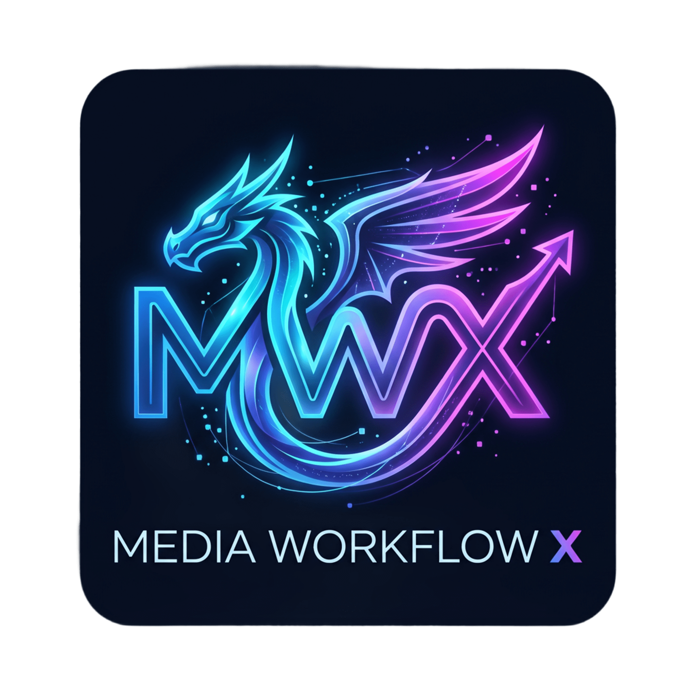

# Media Workflow X 🚀
### Aplikasi Desktop All-in-One: Kompresi Cerdas, Konversi Format, PDF Manager & AI Upscaler

<p align="center">
  
</p>

<p align="center">
  
  
  
  
  
</p>

---

## 📖 Tentang Media Workflow X

**Media Workflow X** adalah perangkat lunak desktop berkinerja tinggi untuk Windows yang dirancang untuk memproses dokumen PDF dan file gambar dalam skala personal maupun korporat. Aplikasi ini menggabungkan antarmuka modern **Flutter Desktop** dengan arsitektur mesin *polyglot* berkecepatan tinggi: **Go (Golang)** untuk orkestrasi & REST server, **C++ Native (OpenCV & QPDF)** untuk kompresi presisi piksel dan proteksi vektor, serta **Real-ESRGAN NCNN Vulkan** untuk *AI Super-Resolution* tanpa memerlukan instalasi Python atau GPU CUDA.

---

## 🌟 Fitur Utama

### 1. 🗜️ Smart Compression (Media Tools)
- **Target-Oriented PDF Compression**: Menyesuaikan ukuran dokumen PDF tepat di bawah batas target ukuran (misal: tepat di bawah 300 KB, 500 KB, dll.) untuk keperluan upload portal ASN, BUMN, perbankan, dan formulir web.
- **Binary Search Quality Tuning**: Algoritma pencarian biner otomatis tingkat kualitas gambar ($30\% - 100\%$) dengan *Resolution Downscale Fallback*.
- **Proteksi Alpha Stempel & Vektor**: Mempertahankan transparansi stempel basah, tanda tangan digital (`/SMask`), dan stencil masks (`/ImageMask`) tanpa pecah atau rusak.

### 2. 🔄 Konversi Dokumen & Gambar Fleksibel
- **Multi-Format Interconversion**: Konversi bolak-balik antara **PDF $\leftrightarrow$ JPG $\leftrightarrow$ PNG $\leftrightarrow$ DOCX (Word)**.
- **Dual Conversion Engine**: Pilihan mesin konversi dokumen antara **Microsoft Word (COM Automation)** atau **LibreOffice Headless Engine** dengan pengaturan timeout dan pemanasan engine otomatis.

### 3. 🔍 AI Super-Resolution (Real-ESRGAN Vulkan)
- **Peningkatan Resolusi Offline**: Memperjelas dan memperbesar gambar hingga **2x, 3x, atau 4x** menggunakan deep learning.
- **Portabel & Mandiri**: Berjalan langsung menggunakan akselerasi GPU Vulkan tanpa memerlukan runtime Python, PyTorch, maupun driver khusus CUDA.
- **PDF Raster Upscale**: Merender dokumen hasil scan yang buram, memperjelas teks dan detail per halaman dengan model AI, dan menyusunnya kembali menjadi PDF resolusi tinggi.

### 4. 📑 PDF Manager Workspace
- **Split Pool**:
  - Pemisahan rentang halaman fleksibel (contoh: `1-3, 5, 8-10`).
  - Ekstraksi setiap halaman menjadi file PDF terpisah dalam 1 kali klik.
- **Reorder & Rotate Pool**:
  - Susun urutan halaman secara visual dengan *drag-and-drop*.
  - Rotasi halaman spesifik (90°, 180°, 270°).
  - Hapus halaman yang tidak diinginkan sebelum disimpan.
- **Merge Pool**:
  - Menggabungkan banyak file PDF menjadi satu dokumen utuh dengan urutan yang dapat disesuaikan.

### 5. 🎨 Desain Modern & Integrasi Sistem
- **Empat Pilihan Tema UI**: Mendukung tema Light, Dark, dan tema khusus sesuai kenyamanan visual.
- **Daemon Otomatis**: Frontend desktop otomatis menyalakan backend engine Go di latar belakang saat aplikasi dibuka dan mematikan proses secara bersih saat aplikasi ditutup.
- **Penyimpanan State & Riwayat**: Konfigurasi mesin, riwayat pemrosesan, dan preferensi output tersimpan otomatis.

---

## 🖼️ Tampilan Antarmuka

| Media Tools & Smart Compression | PDF Manager (Split, Reorder, Merge) |
|:---:|:---:|
|  |  |

| Pilihan Tema Antarmuka | Diagram Alur Sistem |
|:---:|:---:|
|  |  |

---

## 📋 Prasyarat Sistem

1. **Sistem Operasi**: Windows 10 atau Windows 11 (64-bit).
2. **RAM**: Minimal 4 GB (Disarankan 8 GB atau lebih untuk AI Upscaling).
3. **GPU (Opsional)**: Kartu grafis yang mendukung Vulkan (Intel HD Graphics modern, AMD Radeon, atau NVIDIA GeForce) untuk akselerasi Real-ESRGAN AI.
4. **Alat Pengembang (Jika ingin membangun dari sumber)**:
   - [Go](https://go.dev/dl/) versi 1.22 atau lebih baru.
   - [Flutter SDK](https://flutter.dev/docs/get-started/install/windows) versi 3.x stable (dengan Desktop Windows C++ tools).
   - [Inno Setup 6](https://jrsoftware.org/isinfo.php) (untuk membuat file installer `.exe`).

---

## ⚡ Instalasi Cepat & Unduh Tools Otomatis

Untuk menjaga repositori tetap ringan dan bersih, seluruh biner eksternal berukuran besar (seperti **QPDF**, **Real-ESRGAN AI**, dan model-model deep learning) diabaikan oleh `.gitignore`. Anda dapat mengunduh dan menyiapkannya secara otomatis dengan satu langkah:

### Cara 1: Menggunakan Double-Click Batch File (Paling Mudah)
Cukup klik ganda (double-click) file:
```
setup_tools.bat
```

### Cara 2: Menggunakan PowerShell
Buka terminal PowerShell di direktori proyek dan jalankan:
```powershell
powershell -ExecutionPolicy Bypass -File .\setup_tools.ps1
```

### Apa yang Dilakukan Script Ini Secara Otomatis?
1. Mengunduh rilis resmi **QPDF v11.9.1 (Windows MSVC 64-bit)** dan mengekstraknya ke direktori tools.
2. Mengunduh rilis portabel **Real-ESRGAN NCNN Vulkan v0.2.5.0** beserta model-model AI (`*.bin`, `*.param`).
3. Mengompilasi backend Go (`smart_compress_backend.exe`) dan menyinkronkannya ke folder `assets/engine/` frontend.
4. Menyinkronkan biner C++ Native `pdf_compressor.exe` dan dependensi runtime DLL.
5. Menjalankan `flutter pub get` untuk mengunduh semua paket dependensi Flutter.
6. Menampilkan laporan checklist kesiapan seluruh komponen sistem.

---

## 🚀 Menjalankan Aplikasi

### 1. Menjalankan Frontend Desktop (Mode Pengembang)
Pastikan dependensi tools sudah disiapkan dengan script di atas, lalu:
```powershell
cd frontend_desktop
flutter run -d windows
```

### 2. Menjalankan Backend Go Secara Mandiri (REST Server)
Backend dapat dijalankan terpisah sebagai HTTP API server di port `8080`:
```powershell
cd Backend
go run main.go
```
*Server RESTful akan aktif di `http://localhost:8080` (endpoint: `/compress`, `/pdf-workflow`, `/health`).*

### 3. Membuat File Installer Standalone (.exe)
Untuk membuat installer mandiri Windows yang siap didistribusikan:
1. Bangun rilis Flutter Desktop:
   ```powershell
   cd frontend_desktop
   flutter build windows --release
   ```
2. Kompilasi installer menggunakan Inno Setup:
   - Buka file `installer/MediaWorkflowX_Setup.iss` di Inno Setup Compiler, lalu klik **Compile** (atau tekan `Ctrl + F9`).
   - File instalasi setup akan dihasilkan di folder `installer/output/MediaWorkflowX_Setup_v1.0.0.exe`.

---

## 📂 Struktur Direktori Proyek

```
app_pengompres_gambar_pdf/
├── .gitignore                       <-- Konfigurasi pengabaian file biner & cache
├── README.md                        <-- Dokumentasi proyek
├── setup_tools.bat                  <-- Script 1-klik unduh & setup tools
├── setup_tools.ps1                  <-- Skrip PowerShell otomatisasi tools
│
├── Backend/                         <-- REST API Server & Orchestrator (Go)
│   ├── go.mod / go.sum              <-- Dependensi Golang
│   ├── main.go                      <-- Entry point server REST API
│   ├── internal/
│   │   ├── handler/                 <-- HTTP Controller endpoint
│   │   ├── model/                   <-- Model data & DTO JSON
│   │   └── service/                 <-- Business logic (kompresor, konverter, AI upscaler)
│   └── tools/
│       ├── qpdf/                    <-- Tool QPDF stream recompressor & linearizer
│       ├── realesrgan/              <-- Real-ESRGAN Vulkan Portable + AI Models
│       └── pdf_compressor/          <-- Engine C++ Native OpenCV + QPDF
│
├── frontend_desktop/                <-- Antarmuka Desktop Modern (Flutter Windows)
│   ├── pubspec.yaml                 <-- Dependensi & konfigurasi Flutter
│   ├── lib/
│   │   ├── core/                    <-- Service backend, status mesin, window control
│   │   ├── features/
│   │   │   ├── media_tools/         <-- Tampilan kompresi, konversi, dan AI upscale
│   │   │   ├── pdf_manager/         <-- Tampilan Split, Reorder, dan Merge PDF
│   │   │   └── settings/            <-- Tampilan konfigurasi engine & timeout
│   │   └── shared/                  <-- Komponen UI modular, dialog, & sidebar
│   └── assets/
│       ├── images/                  <-- Logo & ikon visual
│       └── engine/                  <-- Runtime biner lokal untuk desktop
│
├── installer/
│   ├── MediaWorkflowX_Setup.iss     <-- Skrip Inno Setup Compiler Windows
│   └── output/                      <-- Direktori installer yang dihasilkan
│
├── Logo/                            <-- Aset branding aplikasi
└── System Flow/                     <-- Diagram arsitektur, flow sistem, & UI mockups
```

---

## 🔒 Kebijakan Repositori & `.gitignore`

Repositori ini mengikuti standar manajemen repositori bersih:
- **Biner Executable & Library**: File biner berukuran besar (`*.exe`, `*.dll`, `*.so`, `*.dylib`, `*.pdb`, `*.bin`, `*.param`) tidak disimpan di git dan diabaikan melalui [.gitignore](file:///.gitignore).
- **Distribusi Tools**: Semua modul eksternal dapat diunduh ulang kapan saja secara otomatis menggunakan script `setup_tools.bat` / `setup_tools.ps1`.
- **Integritas Struktur**: Direktori tools tetap dipertahankan strukturnya melalui file placeholder `.gitkeep` dan dokumentasi terkait.

---

## 📄 Lisensi & Kredit

- **QPDF**: Dikembangkan oleh Jay Berkenbilt ([QPDF GitHub](https://github.com/qpdf/qpdf)) - Lisensi Apache 2.0.
- **Real-ESRGAN**: Dikembangkan oleh Xintao Wang dkk. ([Real-ESRGAN GitHub](https://github.com/xinntao/Real-ESRGAN)) - Lisensi BSD-3-Clause.
- **OpenCV**: Open Source Computer Vision Library ([opencv.org](https://opencv.org)) - Lisensi Apache 2.0.
- Proyek **Media Workflow X** dikembangkan untuk pemrosesan media dan dokumen secara cepat, aman, dan efisien secara lokal di komputer pengguna tanpa ketergantungan server cloud.
